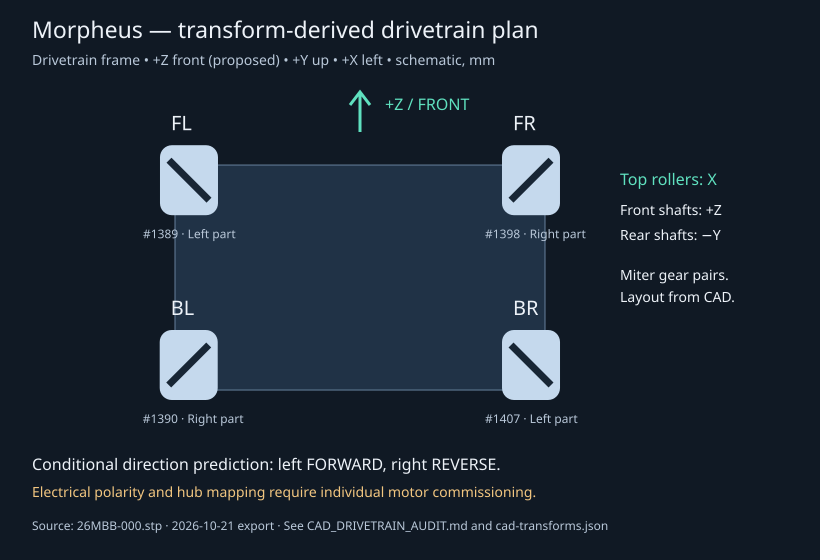

# Morpheus drivetrain CAD audit — 2026-10-22

## Source and method

Read-only inspection of uploaded `26MBB-000.stp` (130,708,017 bytes), exported by Autodesk Inventor 2027 on 2026-10-21 at 16:07:39 -04:00. SHA-256:

`2de933beaa00e79f1bf4a2dd36e8c961ecf188912e3335a9e965c325af3155c8`

The source is not committed or modified. Reproduce the extracted evidence with:

```sh
python3 tools/audit_step.py /path/to/26MBB-000.stp > audit.json
```

[Raw evidence](evidence/cad-transforms.json) includes occurrence IDs, product definitions, source/target placement IDs, complete 4×4 matrices, and 40 roller-axle axes. The extractor follows NEXT_ASSEMBLY_USAGE_OCCURRENCE → CONTEXT_DEPENDENT_SHAPE_REPRESENTATION → REPRESENTATION_RELATIONSHIP_WITH_TRANSFORMATION → ITEM_DEFINED_TRANSFORMATION. It computes parent placement × inverse(child placement). **Parent drivetrain units are inches; wheel and other component representations include millimetres.** Placement translations are converted to millimetres before composition. Ignoring that conversion produces incorrect assembly positions.

This is a scoped AP214 extractor for this export, not a general CAD kernel. It does not solve constraints, simulate gear contact, or assess interference. Geometry checks use motor cylindrical surfaces #485317/#485325/#485329/#485334 (parallel to local Y) and roller-axle surfaces #484540/#485180 (parallel to local Z). Ten axle midpoints per wheel determine the wheel center; transformed axle directions establish the roller slant, rather than relying only on product names.

## Coordinate convention

All coordinates below are **drivetrain subassembly #1573578**, in millimetres; they are not full robot assembly coordinates. Adopt +Y up and **+Z front**, with +X robot left and −X robot right when looking forward. The front designation is a working convention supported by intake-ramp occurrence #1442 at (−96, −20.58, 256), beyond the +Z wheel pair; confirm the team's intended front on the physical robot. Wheel axles run along X. Do not infer port numbers from any of these coordinates.



## Wheels and motor mounting

Wheel center is the mean of the modeled roller axle midpoints, not the wheel part's arbitrary local origin. Top roller axes below are parallel lines, with sign arbitrary; they were mathematically rotated to the top of the wheel from each axle's radial position. All 40 axle checks give a 45° slant within numerical tolerance. The projected axes form an X, with the diagonals pointing toward the chassis center.

| Corner | Wheel occurrence / transform | CAD wheel variant | Center (X, Y, Z), mm | Top roller axis ∥ | Drive motor occurrence / transform | Motor local +Y shaft axis in chassis frame |
| --- | --- | --- | --- | --- | --- | --- |
| FL | #1389 / #420 | Left, 3606-0000-0096 | (171.014, 24, 204) | (1, 0, 1) | #1416 / #447 | (0, 0, 1) |
| FR | #1398 / #429 | Right, 3606-0100-0096 | (−170.986, 24, 204) | (1, 0, −1) | #1413 / #444 | (0, 0, 1) |
| BL | #1390 / #421 | Right, 3606-0100-0096 | (171.286, 24, −60) | (1, 0, −1) | #1419 / #450 | (0, −1, 0) |
| BR | #1407 / #438 | Left, 3606-0000-0096 | (−171.014, 24, −60) | (1, 0, 1) | #1422 / #453 | (0, −1, 0) |

Motor body origins are FL (120, 24, 60.35), FR (−120, 24, 60.35), BL (120, 167.65, −60), BR (−120, 167.65, −60). Front motors are longitudinal; rear motors are vertical. The motor is not coaxial with its wheel. Eight 30T `2319-4008-0030` miter/bevel gear occurrences #1425–#1432 connect these axes to the transverse wheel shafts. Their positions pair each motor with its nearest corner, rather than simply assigning the four motor bodies by front/back position.

Wheel metadata says 70A durometer, nominal 96 mm. All four drive motors reference product definition #1573609, named `435RPM 18.7 kg.cm`. These are **CAD labels**, not measurements of wheel diameter, actual motor variant, speed, torque, or installed parts. No encoder conversion or closed-loop gains are derived from them.

Control Hub occurrence #1437 is around (−11.393, 47.929, −11.587); its internal name says “Expansion Hub” while its description says “REV-Control-Hub.” Expansion Hub #1438 is around (8, 15.929, 32). This naming conflict is retained as a limitation. Hub geometry supplies no electrical channel mapping.

## Direction decision and assumptions

Use `INVERT_LEFT_SIDE = false`, `INVERT_RIGHT_SIDE = true` as a **conditional mechanical prediction and provisional electrical setting**. Disable SolversLib's automatic right-side multiplier with `new MecanumDrive(false, FL, FR, BL, BR)` so inversion is applied once.

Reasoning: assuming equal signed shaft rotation about each motor's local +Y and ideal external 1:1 miter pairs, the modeled mirrored gear placement predicts wheel angular velocity +X on the left and −X on the right. At the ground contact (radial −Y), wheel angular velocity +X corresponds to chassis travel +Z. Reversing the right motors therefore aligns all four wheels for forward travel. Front and rear input axes differ, but their gear placements give the same predicted side relationship. This is an inference from the shaft/gear layout, not a solved gear-contact simulation.

**The assumption that a positive FTC motor command produces the chosen signed local +Y shaft rotation is unverified.** Motor construction, leads, configuration, internal gearing, and installed assembly can change it. The model therefore supports a side relationship, not an electrical proof or hardware acceptance. Commission all four corners; if results differ within a side, replace side constants with independently measured per-corner directions. Never change both library inversion and motor inversion to compensate for the same issue.

## Remaining hardware-dependent unknowns

- Team's physical front, actual installed wheel handedness, and correspondence to this CAD revision.
- Control/Expansion Hub port assignments and exact case-sensitive FTC configuration names.
- Electrical motor polarity and signed shaft response to a positive command.
- Encoder polarity, counts, gearing, and wheel conversion if encoders are later used for control.
- Traction, scrub/slip, latency, braking distance, stability, interference, and drivetrain tracking error.

No physical robot was connected or tested in this software session. Follow [the staged acceptance procedure](DRIVETRAIN_VALIDATION.md) before floor driving.
